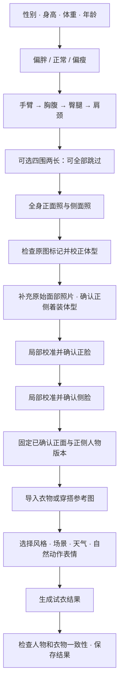

# 映衣间 · Veylfit

**先看见穿在自己身上的样子，再决定怎么穿。**

Veylfit 是一个以本人外观和体型为参考的 AI 虚拟试衣与穿搭项目。它通过简单的体型选择、可选实测尺寸和正侧照片建立人物参考，让用户预览衣服和生活场景中的穿搭效果。

> 阶段：产品方案与本地原型验证。当前仓库是项目初始化与文档基线，**尚未迁入可运行原型源码、模型资产或生成服务**，不能直接下载安装运行。仓库初始设置为私有，不代表已经选定开源许可证。

## 产品流程

体型选择采用手绘示意图，每次只显示当前一步，点选自动前进，可返回修改。人体白模在后台使用，不向用户展示。照片建议穿薄、合身、不塑形的衣物，正常站立，头脚完整；不要求内衣或裸露。

## 什么已经验证，什么还没有

| 能力 | 状态 |
| --- | --- |
| 男模三类体型、四部位各三选项、逐步交互 | 本地原型已实现，功能检查通过 |
| MakeHuman 带骨架模型、后台保存和恢复 | 本地原型已有；不等于真人精度验证 |
| 正侧照片关节点查看和手动修正 | 关节点流程保留；新增原图轮廓标记检查与受限体型校正 |
| 先体型、再正脸、后侧脸、固定后试衣 | 本地逐步流程已接入；三候选为备选，生图仍手动交接 |
| 真实感试衣、薄厚衣服、场景动作 | 少量案例人工验证，不能外推全人群 |
| 四项资料＋可选尺寸＋照片的采集向导 | 本地已接通；照片人工辅助校正通过首测，实测联合拟合待开发 |
| 女性四区、照片与实测联合拟合、自动生图服务 | 待开发和验证 |
| 衣橱、穿搭评分、场合天气推荐 | 后续需求 |

## 文档导航

- [产品与技术方案](docs/产品与技术方案.md)：架构、模块、模型、数据、API、队列、成本、风险。
- [PRD 产品需求文档](docs/PRD-产品需求文档.md)：用户流程、优先级、状态、验收和8周计划。
- [决策记录](docs/决策记录.md)：已确定事项和未决问题。
- [名称检索记录](docs/名称检索记录.md)：候选名检索范围与限制。
- [原型迁移计划](docs/原型迁移计划.md)：如何迁入本地代码且不带入私人数据。
- [隐私与资产边界](docs/隐私与资产边界.md)：照片、档案、密钥和模型资产的处理原则。
- [变更记录](CHANGELOG.md)。

## 项目边界

目标是本人外观一致、衣物特征清楚、场景自然的穿搭参考图。图像看起来合身不代表实际尺码合适；体型估计不宣称测出体脂、肌肉量或厘米级人体尺寸。衣服的视觉松量与人体真实体量分开处理，不通过偷偷缩腰或瘦脸实现“显瘦”。

首轮生图通过对话内置工具手动进行，再将结果回存本地。原型尚未自动调用生图 API；后续提供商适配需逐一验证多图参考、编辑和数据处理能力，不能保证任意生图服务同等支持。

本仓库不存放真人照片、个人模型、生成的人物照片、密钥、外部穿搭图片或私人测量档案。也尚未选择软件开源许可证或重新分发第三方模型素材。

历史项目工作名为 FitLogic。当前名称由项目发起人于2026-11-12选定；检索未发现明确同名项目，但不作全球唯一或商标可注册保证。
