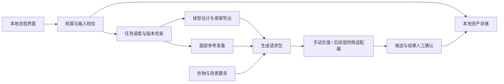

# 映衣间 · Veylfit：产品与技术方案

版本：0.1.4（用户建档保存核查）｜更新：2026-11-12｜来源：本地两份项目基准0.1.59及本次命名/建库决定。

## 1. 背景与目标

用户在普通模特照片上难以判断衣服穿到自己身上的观感。项目选择“高真实度 AI 试衣摄影”路线：建立可复用人物参考，换衣时保留脸部和体型，再探索自然场景、动作和表情。

阶段目标：完成资料采集—体型估计—人物确认—衣物导入—生成—回存的可追溯闭环。先验证人物相似与衣物还原，随后扩展自动化和人群覆盖。

不在当前承诺范围：精确身体扫描、体脂/肌肉量估计、真实布料仿真、尺码保证、自动购买、无需确认的全人群可靠性。

## 2. 证据与文档治理

标记含义：已实现=本地原型有对应代码；案例验证=少量人工试验；规划=尚未接入；待验证=没有足够证据。当前仓库不含原型源码，不能把本地结果当作从仓库可复现的测试。

本文件和[PRD](PRD-产品需求文档.md)是仓库内配套方案，其他文档不得自行改变产品要求。本地两份完整历史文档暂继续作为编辑基准；仓库为去个人数据的同步版本。后续先修订本地基准，再同步这里的对应章节、决策及变更记录。是否把唯一编辑源正式迁移到GitHub需要独立决定，避免形成两套相互矛盾的要求。

## 3. 模块与迭代点

| 模块 | 当前状态 | 下一实现步骤 | 验收重点 / 待讨论 |
| --- | --- | --- | --- |
| M01 基本资料 | 新流程已确定 | 性别/身高/体重/年龄表单、来源、草稿 | 不沿用样例数据；年龄覆盖范围 |
| M02 手绘选体型 | 男模向导v3已有 | 保留三类与四区单步选择，补女性图库 | 全部主动选择；返回与清空后续状态 |
| M03 可选尺寸 | 四区引擎未接入 | 四围两长空值、图示、单位、测量位置 | 空值不是0；冲突不静默覆盖 |
| M04 照片 | 原照导入/关节点修正已有 | 新向导导入与质检，姿态/相机处理 | 衣物遮挡和照片质量不能冒充真实轮廓 |
| M05 体型模型 | 男模启发式估计已有 | 照片与实测约束、比例优化、独立验证 | 保持身高/骨架；不把模型值当真人实测 |
| M06 人物底图 | 手动三候选交接已有 | 合并正侧参考确认、固定版本 | 脸与体型分别确认；改输入使旧候选失效 |
| M07 衣物试穿 | 导入/回存已有 | 生成接口、衣物特征检查 | 厚度、开合、花纹、领型、裤型与身份 |
| M08 场景与搭配 | 人工案例验证 | 用户偏好、场景、气温约束 | 自然克制表情；目标由用户确认 |
| M09 衣橱与点评 | 规划 | 衣物分类确认、购入日期、搭配分析 | 不把购入时长当实际穿着次数 |

每次改动记录模块版本、输入版本、验证方式、未决问题。原型UI版本与几何引擎版本独立，不能用界面升级冒称建模能力升级。

## 4. 体型数据与建模流程

必填基本资料：用户自报性别、身高cm、体重kg、年龄岁。整体体型：偏胖/正常/偏瘦；部位：手臂、胸腹、臀腿、肩颈各三选一。性别用于模板起点，不从脸推断；年龄当前不直接驱动形变。

可选四围：胸围、自然腰围、脐水平腹围、臀围。两项长度：肩宽、人体腿内长。肩宽拟按肩峰点直线距离；腿内长沿用站立裆点到地面垂直高度的项目定义。测量图示与定位方式仍需验证，不能混用裤子内缝长度或衣服肩缝宽。

必需照片：近期、同一体型状态、正常站姿全身正面/侧面照；薄、合身、不塑形衣物，头脚完整。可保存草稿后补拍。对左右不同照片分别估计相机/姿态，不直接共用像素尺。

规划处理顺序：质检与关键点 → 相机/姿态处理 → 身高定尺度 → 体重与外形选项初始化 → 有实测时约束对应位置 → 正面宽度与侧面深度联合调整 → 保持网格/骨架 → 导出标准A姿势 → 独立测量/可见轮廓检查 → 人物参考确认。

现有四区引擎是BMI与区域预设的启发式连续变形，并非身体扫描；它目前不消费照片或四围两长。局部参数作用在连续完整网格，不把身体切成四块硬拼。头部权重保护避免肩颈形变拖动下颌。几何引擎当前范围同时要求身高150–205cm、体重40–150kg、BMI17–36；这是工程支持边界，非医疗标准。

旧MakeHuman拟合器已有身高和可选胸腰臀截面拟合，但固定截面位置及宽深同时缩放不能证明真人围度位置和外形准确。新流程接入必须重新验证，不混淆两套算法。

## 5. 系统结构

当前技术基础：Python/Tkinter本地界面、NumPy几何运算、Pillow图像处理、MakeHuman模板、GLB与本地ZIP项目包。照片关键点依赖需随源码迁移重新固定版本与许可。无需在本次初始化强行改成云服务。

未来可用本地服务承接UI和后台任务，生产多用户部署再评估数据库/队列/对象存储。以下数据/API为规划契约，不是已上线端点。

## 6. 数据模型与版本

| 实体 | 关键字段 |
| --- | --- |
| Profile | id, gender_template, height_cm, weight_kg, age_years, revision |
| ShapeSelection | profile_revision, family, arms, torso, legs, neck, schema_version |
| Measurement | kind, value_cm或null, source, landmark_definition, measured_at |
| Asset | id, role, sha256, local_path, owner_id, consent_scope, retention_state |
| BodyModel | id, input_revision, engine_version, template_version, glb_asset, quality_status |
| CandidateBatch | id, input_revision, provider, prompt_version, 3个候选引用 |
| IdentityReference | candidate_id, face_approved, body_approved, front/oblique_assets, revision |
| Garment | id, source_assets, category, color, texture_notes, review_status |
| TryOnJob | id, identity_revision, garment_revision, scene, pose, expression, status |
| Result | job_id, image_asset, review, rejection_reasons, created_at |

实测、自报、照片估计、模板默认、网格输出分开标记；未采集值为null。人物参考被冻结后修改关键输入产生新版本，旧结果保留历史但不得悄悄挪作新版本。正式产品禁止以样例人物资料填新用户档案。

## 7. API草案

| 契约 | 作用 | 关键约束 |
| --- | --- | --- |
| POST /v1/profiles | 建立草稿 | 单位明确、字段合法 |
| PATCH /v1/profiles/{id} | 修改资料/选择/尺寸 | revision冲突返回409 |
| POST /v1/assets | 导入照片/衣物 | 大小、解码、归属校验 |
| POST /v1/body-jobs | 提交体型处理 | 绑定输入版本、幂等键 |
| GET /v1/jobs/{id} | 查询进度与错误 | 不返回他人数据 |
| POST /v1/candidate-batches | 请求三候选 | 校验参考齐全；绑定生成方式 |
| POST /v1/identities/{id}/confirm | 确认脸与体型 | 两类确认独立记录 |
| POST /v1/tryon-jobs | 发起换衣 | 已确认人物版本及衣物版本 |
| POST /v1/jobs/{id}/results | 手动回存结果 | 批次归属，禁止串人物 |
| DELETE /v1/profiles/{id} | 删除档案及关联资产 | 跟踪派生物/备份/外部删除状态 |

## 8. 队列与失败处理

当前UI线程仅调度，后台线程处理模型，以代次屏蔽过期结果。规划任务状态：draft → queued → running → awaiting_review → succeeded，另有failed/cancelled；awaiting_review不是完成。

幂等键结合用户、输入版本、任务类型及生成设置；重复提交可返回现有任务，用户主动重新生成则建立新attempt。网络超时不默认再次收费生成，先查询提供商任务状态；重试上限与超时按服务实测确定。取消后迟到结果不得覆盖新档案。记录耗时、错误代码、成本，不记录原始照片或密钥。

## 9. 模型方案与许可核查

| 部件 | 当前使用/方向 | 迁移前核查 |
| --- | --- | --- |
| MakeHuman人体模板 | 本地男女基础模板，男性四区已接入 | 原始版本、导出资产许可、附件/拓扑/骨架来源分别登记 |
| 关键点模型 | 现有照片原型依赖待盘点 | 代码和权重分别核查许可、分发范围、模型版本 |
| 人脸参考 | 本地裁剪和用户确认 | 先保留照片参考；不无必要引入身份识别库 |
| 生图服务 | 当前对话内置功能手动交接 | 后续API授权、输入能力、数据保留、计费、地区可用性 |
| 手绘图库 | 本地AI生成示意素材 | 来源与生成记录、可发布性、与真实人物资产区分 |

本次仓库不包含权重、人体模型和图片；不预设所有模型都可商用，也不附加未经选择的开源许可。首次迁入代码前完成依赖清单及所需NOTICE/许可证文件。

## 10. 质量、隐私与成本

质量分开验收：几何可用性、输入追溯、人物相似、体型保持、衣物还原、场景自然。数值检查通过不等于个人外形准确；少量案例不是全人群证据。薄衣/厚衣、正面/斜侧、拉链不同开合状态应对照固定人物版本，避免通过改身体迎合衣服。

本地采集与裁剪优先；生成服务需上传时展示目的、去向与所需图片。不承诺绝对不泄露；原图、缩略图、模型、生成图、备份有一致删除流程。仓库排除真人资产和密钥，日志不写完整本地路径或签名URL。详情见[隐私与资产边界](隐私与资产边界.md)。

成本只记录假设，不引用未经核实的实时价格。设每月新档案N、每人试穿T、单张候选成本Pc、每次试穿图数K、单张试穿成本Pt、平均尝试倍数R，则生成预算近似 N×(3×Pc + T×K×Pt)×R；另计视觉分析、存储、流量、GPU及维护。建立档案的费用与复用人物换衣费用分开计。

示例仅算数量：N=100、T=10、K=1、R=1.3，约1690张生成图的成本加其他费用；Pc/Pt待提供商实际计费确认。订阅内的对话工具使用不能当作未来API单价。

## 11. 风险与未决问题

主要风险：宽松衣物遮挡、身高体重不能唯一决定形状、年龄/人群覆盖不足、左右视图相机不一致、生成模型自动美化瘦身、厚衣被误作身体体量、多轮身份漂移、服务能力/许可变化、隐私数据误提交。

未决：女性形状库；测量位置图示；照片质量阈值；年龄支持范围；正式模板确认策略；第一家API提供商；代码许可证；可独立验证的样本集与量化精度目标。8周建议路线见[PRD](PRD-产品需求文档.md)。

## 12. 模块版本记录

| 日期 | 版本 | 涉及模块 | 结论 | 待讨论 |
| --- | --- | --- | --- | --- |
| 2026-11-12 | 仓库0.1.0 | M01–M09 | 建立去个人数据的方案基线，承接本地原型事实与最新流程 | 原型迁入及各项未决问题 |

## 2026-11-12 本地采集向导v4进展

基本资料→五步手绘体型→可选四围两长→正侧照片→本轮结果，已经在本地原型接通。新用户资料为空；当前仅开放成年男模处理，其他资料可存草稿。照片本地解码、旋正、去EXIF并作单人姿态分析，正侧方向与完整性仍需人工确认；没有宣称全面自动照片质检。

尺寸可全空/部分填；本轮仅保存，不参与几何拟合。照片关节点也尚未驱动四区形变；原照页的手工修正保留为独立流程。新建档包保存输入、照片、后台模型与来源报告，界面不显示白模。修改输入使处理结果失效，重开档案需要复核。

13项本地Tk功能检查以及两视图真实照片的本地处理/回存检查通过；文件与内存原照入口的关节点一致。没有完成桌面截图视觉验收、全人群精度验证或自动人物底图衔接。测试者原图、尺寸、身份与输出不入仓库。

本仓库仍为文档交付，未迁入上述实现源码，不提供可复现启动命令。下一步：用户体验采集流程，再分别完善测量引导、照片/实测联合拟合、女性路径和人物底图确认衔接。

### 本地启动入口修复（2026-11-12）

修复Windows批处理混合换行导致的命令截断与路径错误：入口统一ASCII/CRLF，中文路径由Python处理。新增真实cmd→Python→Tk初始化及档案恢复自检；三种入口/工作目录组合均退出0。此前仅直接运行Python的检查未覆盖此错误。本仓库仍未迁入原型代码或私人档案。

### 品牌名称统一（2026-11-12）

桌面目录、主文档名称、模型文件夹、启动入口、程序标题和新导出名称统一采用映衣间/Veylfit。新人物项目使用`.veylfit-person`，兼容打开旧`.fitlogic`；采集档案仍为`.veylfit`，两种格式分开。内部旧schema和固定模板文件名保留兼容，不修改个人资产。5项本地检查涵盖文件保留/哈希、文档路径、实际桌面批处理启动、新旧人物项目兼容及固定资产保持。历史原型运行库目录仍使用旧工程路径，不作为产品显示名称。

### 用户保存链路核查（2026-11-12）

一份用户实际提交的档案完成本地检查：资料、选择、两视图图片、后台模型及报告齐全；可选尺寸空值保持；图片哈希、输入指纹、保存模型与同输入重新构建的一致性检查通过，原档案和固定参考均未修改。个人资料、图片、档案及可关联个人的哈希不入库。这证明建档保存链路可用，不代表照片已经参与形变或真人外形精度通过；体型仍待本人确认。

## 本地照片校正v5（2026-11-12；当前状态）

已接通原图检查后的照片约束：在正侧照片上拖动身高标尺与腹部、臀部、单侧大腿端点，逐项选择轮廓清楚、宽松衣物上限或不采用。自动候选线默认不应用，检查后才通过平滑受限形变修正宽度/厚度；网格及骨架共同调整。宽松衣物不能直接变成身体轮廓。尚未做透视标定，腿长保留基础比例，四围两长仍只记录。

旧建档文件兼容，新包记录标记、照片来源、审核者和校正前后报告。换照/身高变化或输入更新使旧约束/结果失效；另存且不覆盖固定参考。实际一份用户档案已跑通，8组本地几何/档案/Tk检查与实际批处理启动检查通过。原档案和固定资产保持不变，私人数据及哈希不入库。

使用内置云端生图人工生成同衣同背景正侧参考，供本人确认脸与体型；不是精确网格投影或服装尺码验证，也未自动调用生图API。参考未被用户确认前不升级固定模板。未完成独立真人精度、全人群/女性覆盖或全局自相交验证。

本节替代早期“照片尚未驱动几何”的当前状态；照片/实测联合拟合仍未完成。本仓库只同步去个人数据文档，仍没有原型源码或运行资产。对应本地主文档0.1.60，CHG-063。待办：本人确认、衣物遮挡/拍摄角度提示、实测约束、人群标定、自动生成衔接。

## 体型版本确认与面部回归反馈（2026-11-12）

用户认可一版照片校正体型，已另存本地版本快照，旧参考不覆盖。随后完成轻薄T恤和厚实棉衣各正面/侧面共四张测试。每次都输入原始照片提取的面部参考，但用户反馈面部仍不准确，因此测试图不升级为人物身份基准。体型认可与面部认可分开记录；下一步先修正并确认单张人物面部，再扩展多图。新资产快照不是旧人物项目格式，现有旧模板按钮未在本轮改写。真人资产不上库。对应本地主文档0.1.61、CHG-064。
